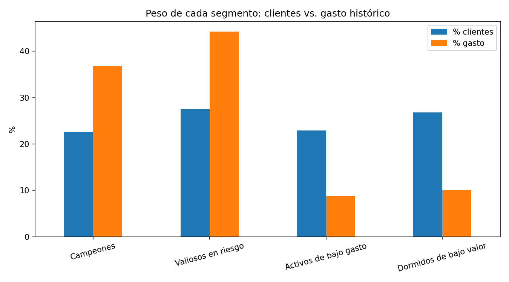

# Segmentación de clientes de e-commerce con RFM y K-Means

Proyecto de análisis de datos que segmenta a ~50,000 clientes de una tienda en línea según su recencia, frecuencia y valor monetario (RFM), identifica qué grupos concentran el gasto y propone una estrategia para cada uno.



## Hallazgo principal

Los dos segmentos de alto valor son aproximadamente la mitad de los clientes, pero concentran **81% del gasto histórico**. El más grande de los dos (**44% del gasto**) es justo el que lleva tiempo sin comprar: clientes valiosos que se están enfriando y que son la prioridad de recuperación.

## Objetivo

Dividir la base de clientes en grupos accionables para decidir dónde conviene invertir en retención, recuperación y crecimiento, y comparar el resultado contra las etiquetas RFM que trae el propio dataset.

## Datos

- **Fuente:** [E-Commerce Customer Segmentation Dataset 2026](https://www.kaggle.com/datasets/datascikhan/e-commerce-customer-segmentation-2026) (Kaggle).
- **Tamaño:** 50,000 clientes, 53 variables (demografía, compras, canal, satisfacción, valor del cliente).
- El archivo original no se incluye en este repositorio. Descárgalo desde el enlace de Kaggle.

## Metodología

1. **Exploración y limpieza**
   - Sin filas duplicadas.
   - Se eliminó `dataset_year` (valor constante).
   - Los vacíos en `loyalty_tier` y `social_media_presence` tienen significado ("sin nivel" y "sin redes"), por lo que se rellenaron en lugar de eliminarse.
   - Se excluyeron **262 clientes sin compras** (0.5%): tienen gasto cero pero días desde la última compra distintos de cero, una inconsistencia del dataset. Se segmentaron **49,738 clientes**.
2. **Variables RFM propias**, construidas desde los datos crudos:
   - Recencia: `days_since_last_purchase`
   - Frecuencia: `total_purchases`
   - Monetario: `total_spent_usd`
3. **Transformaciones según el sesgo de cada variable**

   | Variable | Sesgo original | Transformación | Sesgo final |
   |---|---|---|---|
   | Recencia | 1.76 | log(1+x) | -0.03 |
   | Frecuencia | 0.00 | ninguna | 0.00 |
   | Monetario | 0.97 | raíz cuadrada | 0.21 |

   El logaritmo se probó también en frecuencia y monetario, pero sobrecorregía (sesgo de -1.46 y -1.06).
4. **Escalado** con `StandardScaler`, porque K-Means trabaja con distancias.
5. **Selección de k** con método del codo y silhouette (k de 2 a 10). Se eligió **k = 4** (ver Limitaciones).

## Resultados

| Segmento | % clientes | % gasto histórico | Última compra | Frecuencia (mediana) | Gasto (mediana, USD) | Estrategia |
|---|---|---|---|---|---|---|
| **Campeones** | 22.6% | 36.9% | 0 a 14 días | 149 | ~77,600 | Lealtad, acceso anticipado, referidos |
| **Valiosos en riesgo** | 27.6% | 44.2% | 14 a 365 días (media: 113) | 148 | ~76,400 | Recuperación prioritaria, ofertas personalizadas |
| **Activos de bajo gasto** | 23.0% | 8.8% | 0 a 14 días | 51 | ~15,500 | Venta cruzada, subir el ticket promedio |
| **Dormidos de bajo valor** | 26.8% | 10.1% | 14 a 365 días (media: 113) | 49 | ~15,100 | Campañas de bajo costo |

## Comparación con las etiquetas originales del dataset

Los segmentos se contrastaron con la columna `rfm_category` del dataset:

- **Campeones:** 98.6% coincide con la categoría "Champions".
- **Valiosos en riesgo:** 54.5% aparece como "Champions" y 35.1% como "Loyal" en el dataset; solo 0.5% como "At Risk".

La diferencia se explica por el método. El dataset suma tres puntajes de 1 a 5 y clasifica según el total, de modo que una frecuencia y un monto altos compensan una recencia mala. Además, su puntaje de recencia asigna el máximo a cualquier cliente con compra en los últimos 30 días (~60% de la base). Al tratar la recencia como un eje propio, el clustering detecta clientes valiosos que se están enfriando y que la etiqueta original no marca.

## Limitaciones

- **Datos aparentemente sintéticos.** Casi todas las variables siguen distribuciones parejas entre su mínimo y su máximo, y hay combinaciones poco realistas (por ejemplo, clientes desempleados con ingreso de 150K+). Los resultados demuestran el método más que un hallazgo de negocio real.
- **Estructura de grupos débil.** El silhouette es bajo en todos los valores de k (entre 0.29 y 0.34; ~0.31 para k = 4) y el codo no tiene una esquina marcada. Elegir k = 4 fue una decisión de interpretabilidad (cuadrícula de recencia por valor), no un descubrimiento de grupos naturales. k = 2 tiene el silhouette más alto, pero solo separa por valor e ignora la recencia.
- **"Gasto histórico" es acumulado**, no ingreso de un periodo específico.
- Solo se usaron tres variables RFM; no se incorporaron satisfacción, quejas ni riesgo de fuga.

## Próximos pasos

- Incluir variables de comportamiento (satisfacción, devoluciones, canal) y comparar otros algoritmos (GMM, DBSCAN).
- Replicar la metodología en datos reales de transacciones, por ejemplo el [Brazilian E-Commerce Public Dataset by Olist](https://www.kaggle.com/datasets/olistbr/brazilian-ecommerce).

## Estructura del repositorio

```
├── README.md
├── requirements.txt
├── segmentacion_clientes.ipynb      # Análisis completo paso a paso
├── clientes_segmentados.csv         # Segmento asignado a cada cliente
└── images/
    └── segmentos_clientes_vs_gasto.png
```

## Cómo reproducirlo

1. Descarga el dataset desde Kaggle (viene como `archive.zip`).
2. Instala las dependencias: `pip install -r requirements.txt`
3. Abre `segmentacion_clientes.ipynb` (Jupyter o Google Colab) y ajusta la ruta del archivo en la primera celda.
4. Ejecuta las celdas en orden.

## Herramientas

Python, pandas, NumPy, scikit-learn (K-Means, StandardScaler, silhouette), Matplotlib.

## Autor

**[Tu nombre]**, economista y analista de datos.
[LinkedIn](https://www.linkedin.com/in/tu-perfil) · [Correo](mailto:tu-correo@ejemplo.com)
